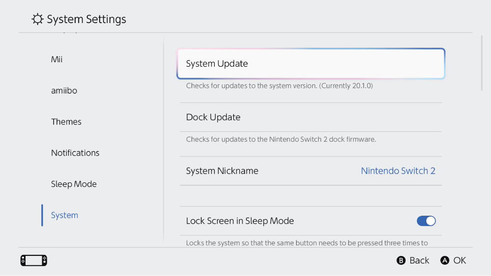

# Primeros pasos

### Lectura obligatoria

Actualmente, la única versión de firmware compatible con homebrew en la Nintendo Switch 2 es la **23.0.1**. Si tienes una versión de firmware superior, no puedes volver a una versión anterior ni usar homebrew.

Aunque el fallo que permite que funcione el exploit existe en versiones anteriores, el exploit en sí no se ha portado a esas versiones. También es posible que las versiones de firmware más antiguas tengan vulnerabilidades más potentes que podrían aprovecharse en el futuro. Dicho esto, si prefieres no esperar y quieres usar homebrew ahora, puedes actualizar a la 23.0.1 actualizando la consola localmente con otra consola que tenga la versión de firmware objetivo.

Si tienes la 23.0.1, o no te importa perderte posibles exploits futuros, podemos empezar. Antes de comenzar, no obstante, debemos asegurarnos de que todos los servicios de Nintendo estén bloqueados correctamente para proteger tu consola de ser incluida en la lista negra.

<!--

### Inclusión en la lista negra (FunctionBlackList)

Nintendo incluye automáticamente en la lista negra los puntos de entrada que se usan para explotar el sistema cuando la consola está conectada a sus servicios en línea. Si tu consola se ha conectado a los servidores de Nintendo después del 12 de noviembre de 2026, ya no podrás usar homebrew.

::: tip

Mantén siempre tu consola desconectada de los servidores de Nintendo para evitar que la incluyan en la lista negra y perder la capacidad de usar homebrew.

:::

### Cómo encontrar tu versión de firmware

1. Enciende tu consola Nintendo Switch 2.
2. Ve a la **Configuración de la consola** desde el menú HOME.
3. Desplázate hacia abajo y selecciona **Sistema**.
4. Tu versión de firmware aparecerá en **Actualización del sistema**.

### Tabla de versiones

| Desde | Hasta | |
|------|----|-|
| 19.0.0 | 23.0.0 | [Actualizar a 23.0.1](/es/guide/updating-to-23.0.1/) |
| 23.0.1 | 23.0.1 | [Elegir tu punto de entrada](/es/guide/choosing-your-entrypoint/) |
| 23.5.0 | 23.5.0 | No compatible |

-->
